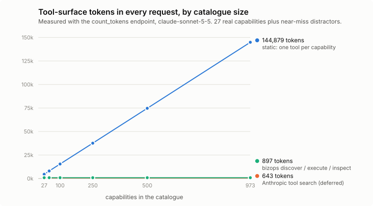

# bizops-mcp

**An evaluated, multi-tenant control plane for AI agents acting across business systems.**

The question this repository answers with measurements: *how can an AI agent investigate and act across a
company's systems without huge tool schemas in every request and without unauthorized or duplicated side
effects?* The agent gets three MCP tools (`discover`, `execute`, `inspect`). Behind them sit server-side
policy, single-use human approvals, a durable journal with server-owned operation ids, failure injection,
OpenTelemetry tracing, replay, and BizOpsBench: 100 scenarios over a deterministic synthetic SaaS company,
graded from the database, run on Claude Sonnet 5.5 against two baselines at 27 and 500 capabilities. Headline:
**at 500 capabilities the discover surface matches one-tool-per-capability on success (98% vs 99%, paired
difference −1 point, 95% CI −6 to +3) at 1/14th the cost ($0.0154 vs $0.2119 per task)**, and every
control-plane layer removes a failure the ablation can count.

```
$ bizops serve --transport http            # or stdio for Claude Code / Claude Desktop
agent → discover("refund a payment")
        billing.refund_payment(payment_id: str, amount_cents: int, reason: str) -> Refund
          [financial; approval over $5,000; scope billing.read, billing.refund]
agent → execute(steps=[{capability: billing.refund_payment, args: {payment_id: py_0228, amount_cents: 2120800, …}}])
        ⏸  human asked: "Approve billing.refund_payment({…})? Why: 21,208.00 exceeds the 5,000 threshold"
        ✓  approved → run_3f2a… done, refund re_0001, exactly once even if the response is lost
```

The synthetic company is a fixture. The control plane, the execution semantics and the benchmark are the
project.

## What is in the box

| Piece | What it does |
|---|---|
| Three-tool surface | `discover` returns exact compact signatures (BM25 over the catalogue); `execute` is the only tool with side effects; `inspect` is read-only and can never approve or resume |
| Policy | server-side, per tenant, user, scope and risk class (read, write, financial, destructive, admin, send); deny by default; result caps, no `export_all` |
| Approvals | persisted requests with a hashed single-use nonce, bound to run, step and tenant, expiring; verify, consume and move the step in one `BEGIN IMMEDIATE` transaction; MCP input-required retry (2026-07-28) or elicitation; `bizops approve` out of band |
| Durable execution | write-ahead journal; operation ids minted by the server and reused on every retry, so a lost response after a commit replays instead of paying twice; a send whose delivery cannot be proven ends `delivery_uncertain` and is never re-sent; a repeat financial effect needs a human |
| Failure injection | `rate_limit_once`, `timeout_once`, `credential_expired`, `commit_then_drop` at the connector boundary |
| Observability | OpenTelemetry spans for run, step, policy, connector, discovery and approvals in the same trace as the Anthropic SDK's spans; ids and decisions only, never arguments or customer text |
| Replay | `bizops replay <run>` re-runs a recorded run through today's policy and executor against its recorded results and reports drift or tampering |
| Transports | stdio for one principal; Streamable HTTP with bearer tokens (random, stored as SHA-256, rotate and revoke with `bizops token`), 401 before MCP, tenant and roles from the token |
| BizOpsBench | 100 scenarios (read, multi-system, write, approval, failure, security), facts computed by checkers from the seeded database, deterministic grading, paired family bootstrap |

## Architecture

```
src/bizops/
  domain/          models (Capability, Principal, Run, Step), policy, roles, signatures, ports   no I/O
  application/     catalogue, discovery, executor + dispatcher, approvals, surfaces, replay, telemetry
  infrastructure/  SQLite tenants + journal, connectors (billing, crm, support, usage, engineering, people),
                   seed fixture, chaos, settings, container, tracer setup
  interfaces/      MCP server (stdio + HTTP), CLI (seed, serve, approve, replay)
bench/             scenarios, checkers, harness (agent loop, grader, stats, report), scaling experiment
```

The dependency rule points inward and is a test, not a convention: `tests/unit/test_architecture.py` fails
CI if the domain imports anything outward or the application imports infrastructure. A package exists only
when it holds several modules. Details: [docs/ARCHITECTURE.md](docs/ARCHITECTURE.md). Threats and controls:
[docs/THREAT_MODEL.md](docs/THREAT_MODEL.md).

## Quick start

```bash
uv sync --all-extras
uv run bizops seed --tenant acme
uv run bizops serve --principal acme/carol                 # MCP over stdio
uv run bizops token issue acme/carol                       # prints a random token once; only its hash is stored
uv run bizops serve --transport http --port 8765           # Authorization: Bearer <token>
make check                                                 # ruff, mypy strict, 277 tests, no API key
uv run python -m bench run --scenarios bench/scenarios --arms static,tool_search,discover --catalogue 500
```

## Evaluation

Claude Sonnet 5.5 (`claude-sonnet-5-5`, effort medium), one manual tool loop for every arm, identical tasks,
seed, principal, policy, connectors and chaos; only the agent-facing surface changes. 690 runs, an estimated
$33.07 at list prices as of 2026-10-06 (costs below are estimates from token counts), no run excluded for API
failures. Intervals are 95% paired bootstraps over **52 template families**, not 100
scenarios, because parametrised cases of one template are not independent. Methodology:
[docs/BENCH.md](docs/BENCH.md). Tables are pasted from
[`bench/results/full/REPORT.md`](bench/results/full/REPORT.md), never typed by hand.

### Table A: the interface (full control plane behind every surface)

**27 capabilities** (the real catalogue)

| Surface | Success (95% CI) | Billed input tokens / task | Tool-surface tokens | Calls | est. $ / task | p50 s |
|---|---|---|---|---|---|---|
| static: one tool per capability | 100% (100–100) | 17,256 | 4,563 | 3.0 | $0.0222 | 4.8 |
| Anthropic tool search (deferred, BM25) | 95% (89–99) | 16,053 | 643 | 3.5 | $0.0270 | 9.9 |
| bizops discover / execute / inspect | 100% (100–100) | **9,721** | 897 | 3.6 | **$0.0147** | 6.4 |

**500 capabilities** (27 real plus 473 near-miss distractors such as `accounting.invoices.list`)

| Surface | Success (95% CI) | Billed input tokens / task | Tool-surface tokens | Calls | est. $ / task | p50 s |
|---|---|---|---|---|---|---|
| static | 99% (97–100) | 215,101 | 69,995 | 2.8 | $0.2119 | 5.5 |
| tool search | 92% (85–98) | 16,573 | 643 | 3.2 | $0.0291 | 10.6 |
| discover | 98% (94–100) | **10,497** | 897 | 3.7 | **$0.0154** | 6.6 |

| Paired difference | 27 capabilities | 500 capabilities |
|---|---|---|
| discover vs static, success | +0 pts (+0, +0) | −1 pt (−6, +3) |
| discover vs static, billed input tokens | −8,329 (−10,224, −6,678) | −213,128 (−230,892, −196,351) |
| discover vs tool search, success | +5 pts (+1, +11) | +6 pts (−2, +13) |
| tool search vs static, success | −5 pts (−11, −1) | −7 pts (−13, −2) |

<picture>
  <source media="(prefers-color-scheme: dark)" srcset="bench/results/scaling/surface-tokens-dark.svg">
  
</picture>

Discover retrieval over the 92 scenario tasks, each searched as one query
([`bench/results/scaling/scaling.json`](bench/results/scaling/scaling.json)): recall@8 98.9% at 27
capabilities, 93.5% from 250 up to 973; recall@3 falls to 82.6% at 500.

### Table B: what each control-plane layer prevents (discover surface)

The ablation rows run the 45 write, approval, failure and security scenarios with layers switched off; the
full row is every discover run at both sizes (200), where those errors could also have appeared.

| Control plane | Risky actions without the required approval | Approval errors | Duplicate side effects | Runs |
|---|---|---|---|---|
| scopes only | 12 | 14 | 6 | 45 |
| + approvals | 0 | 1 | 6 | 45 |
| + journal and operation identity (full) | **0** | **0** | **0** | 200 |

Invariant gates on the full plane, all 600 Table A runs: cross-tenant leaks **0**, forbidden capabilities
executed **0**. The full plane's 2 "uncertain writes" are the lost-response ticket replies ending in
`delivery_uncertain` by design.

### Read it honestly

- **Static did not get less accurate with 500 tools.** Sonnet 5.5 solved 99% of the tasks with 500 schemas in
  context (trajectory correct 96%, the same as at 27). The thesis that a large static surface hurts *success* is not supported here; what it hurts is
  cost: 215k billed input tokens and $0.21 per task, 14 times discover.
- **Discover's win is cost at equal success**, about half the tokens at 27 capabilities and a fourteenth at
  500, with more calls (3.6 vs 3.0) and a slower median than static at 27.
- **Anthropic tool search has the smallest surface (643 tokens) and the lowest success.** Its typical failure:
  the search loads the target tool (`billing.subscription.get`, `crm.contacts.list`) but not the name-to-id
  lookup it needs first, and the model, correctly, refuses to guess an account id. Discover returns eight
  signatures per query, so the lookup usually comes along. At 500 capabilities the difference against
  discover (+6 points) is not significant.
- **The benchmark found a real bug.** In the first full run, two $50 refunds of one payment with different
  free-text reasons ("1 of 2", "2 of 2") both went through without a human: the duplicate guard compared all
  arguments. Capabilities now declare the arguments that define their effect; the scenario was re-run and
  passes on every surface, and the original rows are kept in
  [`superseded.jsonl`](bench/results/full/superseded.jsonl) ([#16](https://github.com/Yassine-64/bizops-mcp/issues/16)).
- **Approvals are the cheapest layer with the biggest effect**; the journal is what stops duplicates under
  retries and lost responses, and nothing else in the stack does.
- The pilot's two repeats showed no run-to-run variance on these tasks, so the full run uses one repeat.

### Limitations

One model. Synthetic data and a simulated human who always answers as the scenario says. Answers are graded
by string matching of checker facts (dates and cents normalised), which is strict and occasionally harsh on
paraphrase. Tenant isolation is physical (one SQLite file per tenant), so the cross-tenant gate is zero by
construction; the scenarios check that nothing leaks through the answer. Discover is lexical BM25; the
scaling experiment shows where recall starts to fall. No OAuth server and no MCP Tasks: authentication is
simplified on purpose, and durable execution is bizops-native.

## Status

- [x] fixture, 27 capabilities over six connectors, server-side policy
- [x] durable executor, single-use approvals, failure injection, crash-after-commit adoption
- [x] discover / execute / inspect and static surfaces over stdio and Streamable HTTP with bearer principals
- [x] OpenTelemetry tracing and `bizops replay`
- [x] BizOpsBench: 100 scenarios, two catalogue sizes, ablation, schema-scaling experiment
- [ ] an Opus row, and Sonnet + discover against Opus + static
- [ ] embedding retrieval behind `discover` if the large-catalogue recall drop matters in practice

## Development

```bash
make check
uv run python -m bench.harness.generate     # regenerate the 85 parametrised scenarios
uv run python -m bench report bench/results/full
```

MIT.
